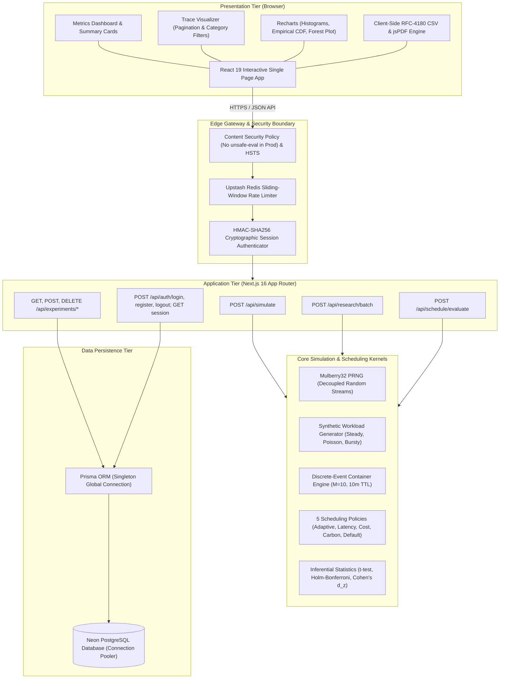
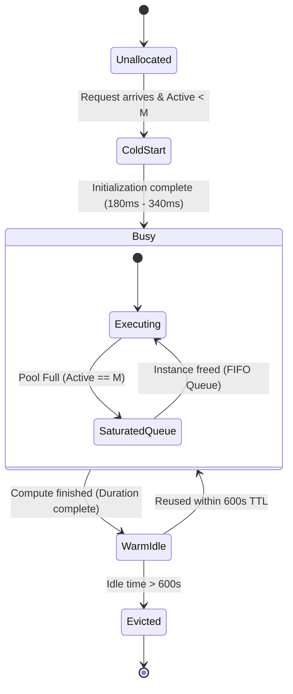
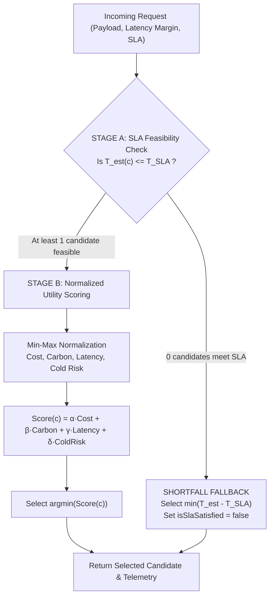
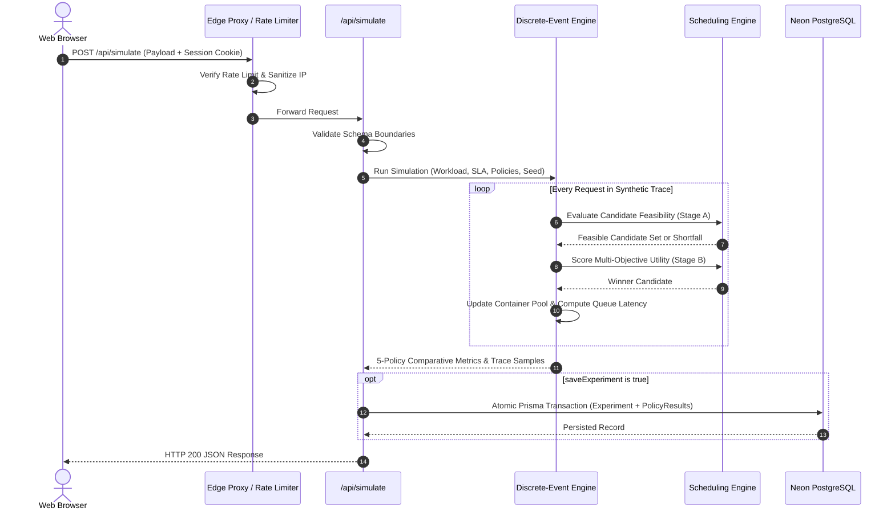
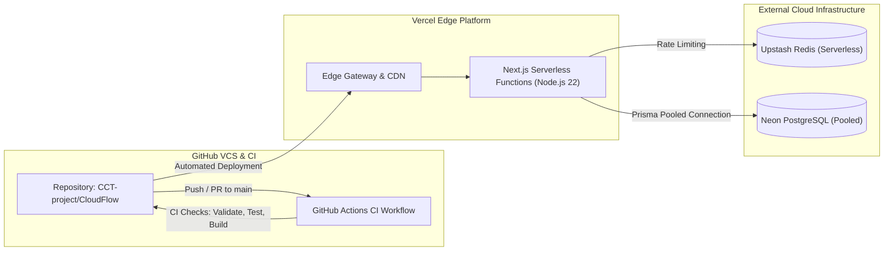

# CloudFlow System Architecture

This document provides a comprehensive technical specification of the system architecture, frontend structure, backend design, simulation engine, scheduling algorithms, database integration, security boundaries, and deployment topology of **CloudFlow**.

---

## 1. Overall System Architecture

CloudFlow is designed as a hybrid research platform providing both an interactive web dashboard for real-time trace exploration and a headless, deterministic discrete-event simulation engine for evaluating multi-objective serverless scheduling algorithms.



---

## 2. Frontend Architecture

The frontend is implemented in **React 19** within Next.js 16's App Router architecture (`app/` and `components/`).

### 2.1 Component Hierarchy & State Management
- **`app/page.tsx` & `components/ecoserve-app.tsx`:** The root orchestrator managing active view states (`'dashboard' | 'research' | 'methodology' | 'settings' | 'preferences'`), active user sessions, and simulation parameters.
- **`components/simulation-results.tsx`:** Container component for rendering simulation outputs:
  - 5 performance summary metric cards (Avg Latency, P95, Total Cost, Carbon, SLA Violations).
  - 5-policy comparative performance table with relative delta badges.
  - Recharts bar charts comparing cost, carbon, and latency across policies.
  - Export action cards supporting RFC-4180 CSV and jsPDF report downloads.
- **Collapsible Deep-Dive Accordions:**
  - **`components/trace-visualizer.tsx`:** High-density trace visualizer with 12-item pagination strip, category filter pills (*All, Cold Starts, Warm Reuses, Queued Requests, SLA Violations*), search bar, and active trace details.
  - **`components/latency-distribution-chart.tsx`:** Interactive histogram with selectable bin widths ($10\text{ms}, 25\text{ms}, 50\text{ms}$) and continuous aligned empirical Cumulative Distribution Function (CDF) step charts.
  - **`components/container-lifecycle-chart.tsx`:** Concurrency visualizer depicting instance allocations, warm reuses, saturation queues, and idle evictions across candidate regions.
  - **`components/statistical-forest-plot.tsx`:** Visual representation of Cohen's $d_z$ effect sizes and 95% confidence intervals against baseline policies.
- **`components/auth-modal.tsx`:** Accessible modal for user registration and authentication, with client-side form validation and accessible focus trapping.
- **`components/settings-views.tsx`:** Clean architectural separation between:
  - `SettingsView`: Read-only empirical system baselines (node hardware specs, baseline latencies, regional grid carbon ratings).
  - `PreferencesView`: Interactive user preferences, theme toggles, and weight presets.

---

## 3. Backend Architecture

CloudFlow's backend runs on **Next.js 16 App Router Route Handlers** (`app/api/*`) executing on Node.js 22 runtime:

```
app/api/
├── auth/
│   ├── login/route.ts         # User authentication & session cookie issuance
│   ├── logout/route.ts        # Session revocation & cookie clearance
│   ├── register/route.ts      # Account creation with bcrypt hashing
│   └── session/route.ts       # Active session verification
├── experiments/
│   ├── route.ts               # GET (paginated listing) & POST (persistence)
│   └── [id]/route.ts          # GET (details) & DELETE (owner authorization)
├── research/
│   └── batch/route.ts         # Multi-seed batch evaluation (k >= 30)
├── schedule/
│   └── evaluate/route.ts      # Single-request candidate evaluation under SLA
└── simulate/
    └── route.ts               # Full 5-policy deterministic workload simulation
```

### 3.1 Input Validation & Boundary Enforcement
Every incoming HTTP request passes through `lib/validation/api-validator.ts` prior to business logic execution:
- Payload schema validation with structured JSON error details.
- Strict boundaries: `1 <= requestCount <= 50,000`, `slaLatencyThresholdMs > 0`, finite positive objective weights summing to $1.0 \pm 0.001$.
- Rejection of unexpected fields, prototype pollution attempts, and malformed types.

---

## 4. Simulation Engine Architecture

The discrete-event simulation kernel (`lib/simulation/engine.ts`) models serverless container execution states over discrete time without executing physical cloud instances.

### 4.1 Container State Machine
Each candidate region maintains an active pool of concurrent instances with a capacity ceiling of $M = 10$:



1. **Cold-Start Allocation:** If all warm instances are busy and active count $< M$, a new container instance is allocated. Cold-start delay ($T_{\text{cold}} \in [180\text{ ms}, 340\text{ ms}]$) is added to turnaround latency.
2. **Warm Container Reuse:** If an unallocated warm container exists whose last execution finished within the idle TTL ($600\text{ seconds}$), it is reused immediately with zero cold-start delay ($T_{\text{cold}} = 0$).
3. **Queueing Under Saturation:** If all $M$ instances are busy, requests are placed into a FIFO queue. Queue delay is calculated as:
   $$T_{\text{queue}} = \max\left(0, \min_{inst}(t_{\text{finish}, inst}) - t_{\text{arrival}}\right)$$
4. **Idle Eviction:** Containers remaining idle $> 600\text{ seconds}$ are automatically purged from memory.

### 4.2 Decoupled PRNG Streams (`lib/simulation/workload.ts`)
To prevent coupling between arrival schedules and task compute times:
- **Arrival Stream:** Seeded with user seed $S_j$. Generates request arrival intervals $\Delta t_i$.
- **Duration Stream:** Seeded with an independent bit-mixed seed $((S_j \oplus \text{0x5DEECE66D}) \gg 0)$. Generates compute durations $t_{\text{exec}} \sim \text{Lognormal}(\mu=4.38, \sigma=0.55)$ clipped to $[15\text{ ms}, 950\text{ ms}]$.
- **Experimental Invariant:** Changing arrival distributions does **not** alter synthetic compute requirements.

---

## 5. Scheduling Engine Architecture

### 5.1 CloudFlow Adaptive Algorithm (`lib/scheduler/adaptive-policy.ts`)



#### Stage A: SLA Feasibility Filter
For each candidate $c \in C$:
$$T_{\text{est}}(c) = L_{\text{base}}(c) + L_{\text{queue}}(c) + \mathbb{I}_{\text{cold}}(c) \cdot L_{\text{cold}}(c) + T_{\text{duration}} + L_{\text{margin}}$$
$$C_{\text{eligible}} = \{ c \in C \mid T_{\text{est}}(c) \le T_{\text{SLA}} \}$$

- **SLA Dominance Principle:** Infeasible candidates are **strictly disqualified** from Stage B. A candidate cannot be selected for lower cost or carbon if it violates the SLA.
- **Shortfall Fallback:** If $C_{\text{eligible}} = \emptyset$, CloudFlow selects:
  $$c^* = \arg\min_{c \in C} \left( T_{\text{est}}(c) - T_{\text{SLA}} \right)$$

#### Stage B: Multi-Objective Utility Scoring
Eligible candidates are scored using min-max normalized metrics:
$$\text{Score}(c) = \alpha \hat{\text{Cost}}(c) + \beta \hat{\text{Carbon}}(c) + \gamma \hat{\text{Latency}}(c) + \delta \hat{R}_{\text{cold}}(c)$$
Default weights: $\alpha = 0.35, \beta = 0.25, \gamma = 0.25, \delta = 0.15$ ($\sum = 1.0$).

### 5.2 Baseline Policies (`lib/scheduler/baseline-policies.ts`)
- **Latency-First:** Selects $\arg\min_{c} T_{\text{est}}(c)$ among feasible candidates.
- **Cost-First:** Selects candidate minimizing direct execution billing among feasible candidates.
- **Carbon-First:** Selects candidate minimizing regional marginal carbon emissions among feasible candidates.
- **Default Baseline:** Cyclic round-robin assignment constrained by Stage A SLA feasibility.

---

## 6. Database Integration & Persistence

- **ORM:** Prisma Client with cached singleton instance in `lib/prisma.ts`.
- **Relational Integrity:**
  - `User` $\to$ `Experiment`: `onDelete: SetNull` ensures user account deletion preserves research benchmarks.
  - `Experiment` $\to$ `PolicyResult`: `onDelete: Cascade` ensures deleting an experiment automatically deletes all associated policy performance records atomically.
- **Error Sanitization:** All database exceptions pass through `sanitizeDatabaseErrorMessage()` to redact credentials, connection URLs, query parameters, and emails before logging or emitting responses.

---

## 7. Authentication, Authorization & Security

### 7.1 Authentication & Session Tokens (`lib/auth/*`)
- **Password Security:** Salted bcrypt hashing with 10 salt rounds.
- **HMAC Session Tokens:** Cookies formatted as `<base64Payload>.<hmacSignature>` signed with `SESSION_SECRET`.
- **Constant-Time Verification:** Uses `crypto.timingSafeEqual()` to protect against timing attacks.
- **Production Validation:** In production, `validateSessionSecretConfig()` enforces minimum 32 characters and forbids default development fallbacks.

### 7.2 Multi-Tenant Data Isolation (`lib/storage/experiments.ts`)
- **Public Records:** Viewable by all users (`isPublic = true`).
- **Private Records:** Accessible exclusively by verified owner (`userId === session.userId`).
- **Unassigned Private Records:** Access is denied (`ForbiddenError`).
- **Deletion Security:** Only the verified owner can delete an experiment. Cross-account deletion throws HTTP 403 Forbidden.
- **Trust Boundary:** User ID is extracted exclusively from the verified server-side session cookie, completely ignoring client-supplied body parameters.

### 7.3 Distributed Rate Limiting (`lib/rate-limit/limiter.ts`)
- Backed by Upstash Redis sliding window.
- Edge IP resolution: Prioritizes Vercel Edge `x-real-ip` with strict IPv4/IPv6 validation.
- Privacy: IPs are hashed using SHA-256 and salted with `SESSION_SECRET`.
- Fail-Closed Policy: In production, unconfigured or unreachable Redis instances cause mutating routes to fail closed (HTTP 503) to prevent unprotected brute-force abuse.

---

## 8. End-to-End Data Flow



---

## 9. Deployment Architecture



- **Hosting Platform:** Vercel Edge Serverless Infrastructure.
- **Database:** Serverless PostgreSQL on Neon with connection pooling (`-pooler`).
- **Production URL:** [https://cloud-flow-kappa.vercel.app](https://cloud-flow-kappa.vercel.app)
- **Bundler:** Next.js with Webpack fallback (`next build --webpack`) ensuring complete WASM SWC compatibility across all host operating systems.
