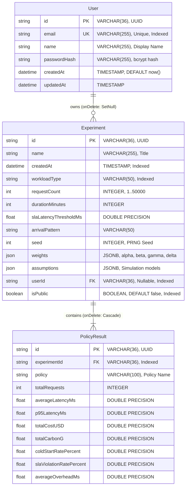

# CloudFlow Database Schema & Persistence Architecture

This document specifies the relational database schema, Prisma models, entity relationships, primary and foreign keys, user ownership rules, and transactional operations implemented in CloudFlow.

---

## 1. Relational Entity-Relationship Diagram



---

## 2. Prisma Models & Schema Definition

The Prisma schema is defined in `prisma/schema.prisma`:

```prisma
datasource db {
  provider  = "postgresql"
  url       = env("DATABASE_URL")
  directUrl = env("DIRECT_URL")
}

generator client {
  provider = "prisma-client-js"
}

model Experiment {
  id                    String         @id @default(uuid())
  name                  String
  createdAt             DateTime       @default(now())
  workloadType          String
  requestCount          Int
  durationMinutes       Int
  slaLatencyThresholdMs Float
  arrivalPattern        String
  seed                  Int
  weights               Json
  assumptions           Json
  userId                String?
  isPublic              Boolean        @default(false)
  user                  User?          @relation(fields: [userId], references: [id], onDelete: SetNull)
  policyResults         PolicyResult[]

  @@index([createdAt])
  @@index([workloadType])
  @@index([userId])
  @@index([isPublic])
  @@map("experiments")
}

model PolicyResult {
  id                      String      @id @default(uuid())
  experimentId            String
  experiment              Experiment  @relation(fields: [experimentId], references: [id], onDelete: Cascade)
  policy                  String
  totalRequests           Int
  averageLatencyMs        Float
  p95LatencyMs            Float
  totalCostUSD            Float
  totalCarbonG            Float
  coldStartRatePercent    Float
  slaViolationRatePercent Float
  averageOverheadMs       Float

  @@unique([experimentId, policy])
  @@index([experimentId])
  @@map("policy_results")
}

model User {
  id           String       @id @default(uuid())
  email        String       @unique
  name         String
  passwordHash String
  createdAt    DateTime     @default(now())
  updatedAt    DateTime     @updatedAt
  experiments  Experiment[]

  @@index([email])
  @@map("users")
}
```

---

## 3. Data Dictionary & Table Specifications

### 3.1 `users` Table
Stores registered researcher accounts.

| Column | Type | Constraints | Description |
|---|---|---|---|
| `id` | `VARCHAR(36)` | `PRIMARY KEY, DEFAULT uuid()` | Unique user identifier. |
| `email` | `VARCHAR(255)` | `UNIQUE, NOT NULL` | Login email address (indexed). |
| `name` | `VARCHAR(255)` | `NOT NULL` | Display name of researcher. |
| `passwordHash` | `VARCHAR(255)` | `NOT NULL` | Salted bcrypt password hash. |
| `createdAt` | `TIMESTAMP` | `DEFAULT now(), NOT NULL` | Registration timestamp. |
| `updatedAt` | `TIMESTAMP` | `NOT NULL` | Last update timestamp. |

- **Indexes:** `users_email_idx` ON `users(email)`.

---

### 3.2 `experiments` Table
Stores workload simulation parameters, SLA thresholds, PRNG seeds, and ownership metadata.

| Column | Type | Constraints | Description |
|---|---|---|---|
| `id` | `VARCHAR(36)` | `PRIMARY KEY, DEFAULT uuid()` | Unique experiment identifier. |
| `name` | `VARCHAR(255)` | `NOT NULL` | Experiment title. |
| `createdAt` | `TIMESTAMP` | `DEFAULT now(), NOT NULL` | Creation timestamp (indexed). |
| `workloadType` | `VARCHAR(50)` | `NOT NULL` | Workload category (indexed). |
| `requestCount` | `INTEGER` | `NOT NULL` | Number of requests simulated ($1 \le N \le 50,000$). |
| `durationMinutes` | `INTEGER` | `NOT NULL` | Synthetic time window. |
| `slaLatencyThresholdMs` | `DOUBLE PRECISION` | `NOT NULL` | Strict SLA latency threshold ($T_{\text{SLA}}$). |
| `arrivalPattern` | `VARCHAR(50)` | `NOT NULL` | Arrival distribution (`Steady`, `Poisson`, `Bursty`). |
| `seed` | `INTEGER` | `NOT NULL` | PRNG seed for deterministic reproduction. |
| `weights` | `JSONB` | `NOT NULL` | Adaptive objective weights ($\alpha, \beta, \gamma, \delta$). |
| `assumptions` | `JSONB` | `NOT NULL` | Documented simulation models and constants. |
| `userId` | `VARCHAR(36)` | `NULLABLE, REFERENCES users(id)` | Owner user account foreign key (indexed). |
| `isPublic` | `BOOLEAN` | `DEFAULT false, NOT NULL` | Public benchmark visibility flag (indexed). |

- **Foreign Key:** `userId` references `users(id)` with `ON DELETE SET NULL`.
- **Indexes:**
  - `experiments_createdAt_idx` ON `experiments(createdAt)`
  - `experiments_workloadType_idx` ON `experiments(workloadType)`
  - `experiments_userId_idx` ON `experiments(userId)`
  - `experiments_isPublic_idx` ON `experiments(isPublic)`

---

### 3.3 `policy_results` Table
Stores comparative performance metrics for each policy evaluated within an experiment.

| Column | Type | Constraints | Description |
|---|---|---|---|
| `id` | `VARCHAR(36)` | `PRIMARY KEY, DEFAULT uuid()` | Unique result identifier. |
| `experimentId` | `VARCHAR(36)` | `NOT NULL, REFERENCES experiments(id)` | Parent experiment foreign key (indexed). |
| `policy` | `VARCHAR(100)` | `NOT NULL` | Evaluated policy name. |
| `totalRequests` | `INTEGER` | `NOT NULL` | Total requests evaluated. |
| `averageLatencyMs` | `DOUBLE PRECISION` | `NOT NULL` | Mean turnaround latency. |
| `p95LatencyMs` | `DOUBLE PRECISION` | `NOT NULL` | 95th percentile tail latency. |
| `totalCostUSD` | `DOUBLE PRECISION` | `NOT NULL` | Total billed compute cost in USD. |
| `totalCarbonG` | `DOUBLE PRECISION` | `NOT NULL` | Total carbon emissions in $g\text{CO}_2\text{eq}$. |
| `coldStartRatePercent` | `DOUBLE PRECISION` | `NOT NULL` | Cold-start percentage. |
| `slaViolationRatePercent` | `DOUBLE PRECISION` | `NOT NULL` | Percentage exceeding SLA threshold. |
| `averageOverheadMs` | `DOUBLE PRECISION` | `NOT NULL` | Mean decision execution time. |

- **Foreign Key:** `experimentId` references `experiments(id)` with `ON DELETE CASCADE`.
- **Constraints & Indexes:**
  - `policy_results_experimentId_policy_key` (`UNIQUE(experimentId, policy)`)
  - `policy_results_experimentId_idx` ON `policy_results(experimentId)`

---

## 4. User Ownership & Multi-Tenant Data Isolation

The persistence layer (`lib/storage/experiments.ts`) enforces strict fail-closed data isolation:

```mermaid
flowchart TD
    QUERY["Incoming Experiment Query / Mutation"] --> AUTH_CHECK{"Is Request Authenticated?"}

    AUTH_CHECK -->|No (Anonymous)| ANON_RULES{"Is Experiment Public?<br/>(isPublic == true)"}
    ANON_RULES -->|Yes| ALLOW_ANON["Allow Read Access"]
    ANON_RULES -->|No| DENY_ANON["Deny Access (403 Forbidden)"]

    AUTH_CHECK -->|Yes (Authenticated)| USER_RULES{"Ownership Evaluation"}
    USER_RULES -->|User Owns Record (exp.userId == session.userId)| ALLOW_OWNER["Allow Read / Delete Access"]
    USER_RULES -->|Shared Public Record (exp.isPublic == true)| ALLOW_READ["Allow Read Access (Delete Barred)"]
    USER_RULES -->|Belongs to Another User (Private)| DENY_CROSS["Deny Access (403 Forbidden)"]
    USER_RULES -->|Unassigned Record (userId == null & isPublic == false)| DENY_UNASSIGNED["Deny Access (403 Forbidden)"]
```

1. **Read Authorization (`getExperimentById`):**
   - Public experiments (`isPublic: true`) are readable by all users.
   - Private experiments are readable strictly when `session.userId === exp.userId`.
   - Cross-user private access or unassigned private access returns HTTP 403 Forbidden.
2. **Delete Authorization (`deleteExperiment`):**
   - Deletions require verified authenticated owner session (`session.userId === exp.userId`).
   - Cross-account deletions or unauthenticated deletion attempts return HTTP 403 Forbidden.
3. **Server-Side Session Trust:**
   - User identity is resolved exclusively from the verified HMAC-signed session cookie. Client-supplied `userId` fields in request bodies are discarded.

---

## 5. Transactional Database Operations

All multi-table writes are wrapped in **Prisma Transactions** (`prisma.$transaction`) to guarantee ACID properties:
- **Experiment Creation:** The parent `Experiment` record and all associated `PolicyResult` records are inserted in a single atomic transaction. If any policy result insert fails, the experiment record rolls back completely.
- **Cascading Deletion:** Deleting an experiment triggers foreign key `onDelete: Cascade` at the database level, automatically purging all associated policy results atomically.
- **Database Error Sanitization:** Prisma exceptions pass through `sanitizeDatabaseErrorMessage()` to redact database URLs, credentials, and parameters before emitting responses.
