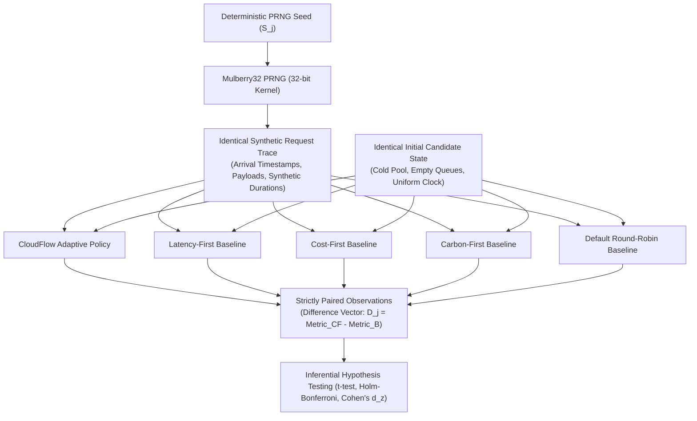

# CloudFlow Research Methodology & Statistical Validation

This document outlines the scientific methodology, experimental design, workload generation models, fair benchmarking principles, and inferential statistical testing frameworks implemented in CloudFlow.

---

## 1. Research Problem & Objectives

### 1.1 The Multi-Objective Serverless Challenge
Serverless computing platforms (AWS Lambda, Google Cloud Functions, Azure Functions) decouple application development from infrastructure management. However, standard scheduling mechanisms present significant research challenges:
1. **Conflicting Objectives:** Turnaround latency, monetary execution cost, and environmental carbon footprint frequently conflict. For example, routing to a distant renewable-powered data center reduces carbon emissions but increases network round-trip time.
2. **Cold-Start Latency Degradation:** Container provisioning and cold initialization overhead ($180\text{ ms} \to 340\text{ ms}$) degrade tail percentiles ($P_{95}, P_{99}$), frequently triggering Service Level Agreement (SLA) violations.
3. **SLA Fragility under Optimization:** Naive weighted scoring algorithms trade away latency bounds to achieve fractional cost or carbon savings, violating contractual SLA guarantees.

### 1.2 Core Research Objectives
- **Strict SLA Feasibility Dominance:** Implement an algorithm where SLA satisfaction strictly gates multi-objective utility scoring.
- **Fair Empirical Comparison:** Eliminate confounding variance by evaluating all candidate policies against identical synthetic request traces.
- **Pooled Statistical Rigor:** Evaluate tail distributions using pooled request-level quantiles and inferential hypothesis testing ($k \ge 30$ seeds).

---

## 2. Fair Benchmarking Methodology

To guarantee scientific validity, CloudFlow adheres to strict experimental invariants:

### 2.1 Experimental Invariants
1. **Identical Request Sequences:** For any evaluated seed $S_j$, every scheduling policy evaluates the exact same incoming request sequence, with identical timestamps, payload sizes, and compute requirements.
2. **Identical Initial System States:** All policies start with clean, identical candidate pool states: zero warm containers, empty FIFO queues, and synchronized simulation clocks.
3. **Identical Candidate Configurations:** All schedulers evaluate the same four heterogeneous multi-cloud candidates:
   - AWS Lambda us-east-1 (Virginia): Low base latency ($120\text{ms}$), moderate carbon intensity ($380\text{ gCO}_2/\text{kWh}$).
   - AWS Lambda eu-west-1 (Ireland): Moderate latency ($180\text{ms}$), low carbon intensity ($210\text{ gCO}_2/\text{kWh}$).
   - GCP us-central1 (Iowa): Moderate latency ($150\text{ms}$), high carbon intensity ($485\text{ gCO}_2/\text{kWh}$).
   - Azure westeurope (Netherlands): High latency ($210\text{ms}$), very low carbon intensity ($160\text{ gCO}_2/\text{kWh}$).

---

## 3. Workload Generation Models

Trace generation (`lib/simulation/workload.ts`) uses the 32-bit `Mulberry32` PRNG with decoupled streams:
- **Arrival Stream:** Governs request inter-arrival timestamps $\Delta t_i$.
- **Duration Stream:** Seeded with independent bit-mixed seed $((S_j \oplus \text{0x5DEECE66D}) \gg 0)$, generating synthetic compute runtimes from a log-normal distribution ($15\text{ ms} \le t_{\text{exec}} \le 950\text{ ms}$).

### 3.1 Arrival Process Formulations
1. **Steady Workload (Uniform / Paced):**
   $$\Delta t_i = \frac{1}{\lambda} \cdot \left(1 + \epsilon \cdot (U_i - 0.5)\right), \quad \epsilon = 0.05, \quad U_i \sim \mathcal{U}(0, 1)$$
   Maintains container reuse saturation and evaluates steady-state scheduling overhead.
2. **Poisson Process (Stochastic Memoryless):**
   $$\Delta t_i = -\frac{\ln(1 - U_i)}{\lambda}, \quad U_i \sim \mathcal{U}(0, 1)$$
   Models uncorrelated web request arrivals.
3. **Clustered Bursty Workload (Two-State Markov-Modulated):**
   $$\Delta t_{\text{burst}} = \frac{\Delta t_{\text{base}}}{10}$$
   Forces container pool saturation ($M=10$), inducing cold starts, queueing backlogs, and triggering shortfall fallbacks.

---

## 4. Evaluation Metrics & Quantile Aggregation

### 4.1 Pooled Request-Level P95 Latency vs. Average of P95s

> [!IMPORTANT]
> **Methodological Standard:**
> When aggregating performance across multiple seeds ($k \ge 30$), CloudFlow calculates **pooled request-level P95 latency** rather than averaging the individual experiment-level P95 values.

Averaging P95 values across multiple experiments is mathematically unsound because percentiles are non-linear order statistics. Instead, CloudFlow concatenates the exact request latency observations from all seeds:
$$\mathbf{L}_{\text{pooled}} = \bigcup_{j=1}^k \mathbf{L}_j$$
$$L_{P95, \text{pooled}} = \mathbf{L}_{\text{pooled}, \left(\lceil 0.95 \cdot (k \cdot N) \rceil\right)}$$

### 4.2 Standard Metric Formulations
- **Execution Cost ($ USD):** Duration billed in 100ms tiers (AWS Lambda standard) + $\$0.0000002$ base invocation fee.
- **Carbon Footprint ($g\text{CO}_2\text{eq}$):** Active power ($35\text{W/core}$) $\times$ duration $\times$ regional grid intensity $\times$ facility PUE ($1.12 \to 1.20$).
- **Cold-Start Rate (%):** Proportion of invocations requiring container initialization ($T_{\text{cold}} \in [180\text{ms}, 340\text{ms}]$).
- **SLA Violation Rate (%):** Proportion of total requests exceeding $T_{\text{SLA}}$.
- **Scheduling Overhead ($\text{ms}$):** Monotonic decision latency measured via `performance.now()`.

---

## 5. Inferential Statistical Hypothesis Testing

To prove whether differences between CloudFlow and baseline policies are statistically significant or the product of stochastic noise, CloudFlow implements paired inferential tests across $k \ge 30$ independent deterministic seeds.

### 5.1 Paired Student's $t$-Test
Because all policies execute against identical request traces, observations are paired:
$$D_j = M_{\text{CloudFlow}, j} - M_{B, j}, \quad j = 1, \dots, k$$

- Sample Mean Difference: $\bar{D} = \frac{1}{k} \sum_{j=1}^k D_j$
- Sample Variance of Differences: $s_D^2 = \frac{1}{k - 1} \sum_{j=1}^k (D_j - \bar{D})^2$
- Standard Error: $\text{SE} = s_D / \sqrt{k}$
- Test Statistic:
  $$t = \frac{\bar{D}}{\text{SE}}, \quad \text{with } df = k - 1$$
- Two-Tailed $p$-Value: Derived from the Student's $t$ cumulative distribution function $F_{t, df}(t)$.

### 5.2 Family-Wise Error Rate (FWER) Control: Holm-Bonferroni
Testing CloudFlow against 4 baseline policies ($m = 4$) per metric inflates Type I errors. CloudFlow applies the **Holm-Bonferroni step-down correction**:
1. Raw $p$-values are sorted: $p_{(1)} \le p_{(2)} \le \dots \le p_{(m)}$.
2. Each $p_{(r)}$ is tested against adjusted threshold:
   $$\alpha_{(r)} = \frac{\alpha}{m - r + 1}, \quad \alpha = 0.05$$
3. Sequential evaluation stops at the first $r$ where $p_{(r)} > \alpha_{(r)}$.

### 5.3 Effect Size Quantification (Cohen's $d_z$)
Cohen's $d_z$ measures the practical magnitude of paired differences:
$$d_z = \frac{|\bar{D}|}{s_D}$$
- $|d_z| < 0.20$: **Negligible**
- $0.20 \le |d_z| < 0.50$: **Small**
- $0.50 \le |d_z| < 0.80$: **Medium**
- $|d_z| \ge 0.80$: **Large** (substantial practical advantage)

---

## 6. Automated Headless Benchmarking Kernel & Large-Scale Evaluation

To eliminate synchronous HTTP serverless gateway timeouts (10s on Vercel Hobby, 60s on Pro) when scaling to large request volumes ($1\text{K}, 5\text{K}, 10\text{K},$ and $50\text{K}$ requests per seed across $k \ge 30$ seeds), CloudFlow provides a standalone headless benchmarking kernel (`scripts/research-runner.ts`).

### 6.1 Avoidance of Jensen's Inequality Fallacy (Pooled Quantiles)
A common methodological error in serverless benchmarking is computing $P_{95}$ per seed repetition and calculating the arithmetic mean of those percentiles. Because percentile functions in queueing systems are non-linear and convex, Jensen's inequality dictates:
$$\mathbb{E}[P_{95}(X_i)] \ne P_{95}\left(\bigcup_{i=1}^k X_i\right)$$
Averaging percentiles introduces systematic bias. To compute mathematically defensible tail metrics, the headless CLI concatenates all individual request latency observations across all $k$ seeds into a unified pooled population vector:
$$L_{\text{pooled}} = [l_1, l_2, \dots, l_{N \times k}]$$
True population quantiles are computed directly on this pooled vector:
$$P_q = \text{Quantile}(L_{\text{pooled}}, q), \quad q \in \{50, 90, 95, 99\}$$
Both the pooled population $P_{95}$ and the sample mean of per-seed $P_{95}$ values are reported for complete transparency.

### 6.2 Provenance Tracking & Reproducibility Manifests
Every headless benchmark execution automatically generates an empirical audit manifest (`reproducibility-manifest.json`):
- Git commit hash at execution time.
- Node.js runtime version and hardware architecture.
- Full PRNG seed sequence (`seedStart .. seedStart + k - 1`).
- Exact command-line reproduction string.
- Progressive file flush mechanism preventing data loss upon process interruption.

---

## 7. Multi-Dimensional Sensitivity Analysis Framework

To evaluate scheduler robustness and prevent cherry-picked benchmark conclusions, CloudFlow incorporates a multi-dimensional sensitivity analysis framework (`lib/research/sensitivity.ts`, `scripts/sensitivity-runner.ts`):

### 7.1 Adaptive Objective Weight Sensitivity
The adaptive policy scoring function is defined as:
$$S_i = \alpha \cdot \text{Cost}_i^{\text{norm}} + \beta \cdot \text{Carbon}_i^{\text{norm}} + \gamma \cdot \text{Latency}_i^{\text{norm}} + \delta \cdot \text{ColdRisk}_i^{\text{norm}}$$
Subject to:
$$\alpha + \beta + \gamma + \delta = 1.0, \quad \alpha, \beta, \gamma, \delta \ge 0$$

The sensitivity framework systematically evaluates five standardized objective presets plus custom combinations:
1. **Balanced:** $\alpha = 0.25, \beta = 0.25, \gamma = 0.25, \delta = 0.25$ (uniform trade-off).
2. **Cost-Prioritized:** $\alpha = 0.70, \beta = 0.10, \gamma = 0.10, \delta = 0.10$ (financial priority).
3. **Carbon-Prioritized:** $\alpha = 0.10, \beta = 0.70, \gamma = 0.10, \delta = 0.10$ (green cloud priority).
4. **Latency-Prioritized:** $\alpha = 0.10, \beta = 0.10, \gamma = 0.70, \delta = 0.10$ (performance priority).
5. **Cold-Start-Prioritized:** $\alpha = 0.10, \beta = 0.10, \gamma = 0.10, \delta = 0.70$ (warm reuse priority).
6. **Default CloudFlow:** $\alpha = 0.35, \beta = 0.25, \gamma = 0.25, \delta = 0.15$ (empirically calibrated default).

### 7.2 SLA Latency Threshold Sensitivity
Evaluates scheduler behavior across a spectrum of operational constraints:
- **Tight SLA ($150\text{ ms}$):** Shrinks the Stage A candidate feasibility pool. When all candidates exceed the threshold, the deterministic shortfall fallback mechanism activates:
  $$\text{Candidate}_{\text{selected}} = \arg\min_c \left(\max(0, T_{\text{est}, c} - T_{\text{SLA}})\right)$$
- **Medium SLA ($250\text{ ms}, 400\text{ ms}$):** Typical production service thresholds where cold candidates are penalized and warm candidates satisfy constraints.
- **Relaxed SLA ($600\text{ ms}$):** All candidates satisfy SLA feasibility ($100\%$ feasible), allowing Stage B to aggressively optimize cost and carbon.

### 7.3 Workload Traffic Dynamics
Evaluates robustness across three distinct queueing regimes over identical seed traces:
- **Steady:** Constant deterministic inter-arrival intervals maximizing container warm reuse.
- **Poisson:** Memoryless exponential inter-arrival intervals ($\lambda = \text{rate}$) testing container idle TTL expiration.
- **Bursty:** Compound Poisson arrivals with high variance and clustering testing concurrency saturation and queueing delay.

### 7.4 Statistical vs. Practical Significance Separation
For large sample sizes ($N \ge 30,000$), statistical tests often return microscopic $p$-values ($p < 10^{-6}$) for trivial shifts. CloudFlow explicitly distinguishes:
- **Statistical Significance:** Paired Student's t-test with Holm-Bonferroni correction ($p_{\text{adj}} < 0.05$).
- **Practical Significance:** Domain thresholds:
  - Execution Cost: $|\Delta| \ge 5\%$ and Cohen's $d_z \ge 0.2$.
  - Carbon Footprint: $|\Delta| \ge 5\%$ and Cohen's $d_z \ge 0.2$.
  - Response Latency: $|\Delta| \ge 10\text{ ms}$ and Cohen's $d_z \ge 0.2$.
  - SLA Violations: $|\Delta| \ge 1.0$ percentage point.

---

## 8. Scientific Integrity & Experimental Boundaries

> [!CAUTION]
> **Simulation Boundary Declaration:**
> CloudFlow's evaluation results are generated by a **discrete-event trace simulator** calibrated against empirical cloud provider characteristics reported in academic literature. The project does **not** claim live physical measurements on physical AWS/GCP/Azure hypervisors in these benchmarks. All results must be scientifically reported as simulated discrete-event benchmarks.
